# 水利学报返修协作稿

这份文件从2026年10月28日起作为正文和逐条回复共同打磨的主稿。可以直接手动修改，后续按作者指示在同一文件中改动。暂不反复生成Word，定稿后统一排版。原题保留；公式使用可编辑LaTeX。

正文从下方“论文正文”开始；逐条回复在后半部分。当前尚有5条意见待补算或核实，不能直接投稿。工作进度详见任务台账。

需要优先核定：清江送审结果来源、平均入流与代码离散的一致性、表1实际搜索边界。请勿把尚未核定的数值当作新结论。

## 论文正文

基于水能互补方程的河道洪水演算方法

闫宝伟，杨东旭，常建波，杜世雄，周学叡

（华中科技大学土木与水利工程学院，武汉，430074）

摘要：为描述洪水传播时滞与河槽蓄泄共同引起的流量过程变化，借鉴水能互补方程的双重约束数学形式构建RWEC河道洪水演算模型。模型以有效传播时间表征入流过程的显式时间平移，以可供水量和潜在滞蓄量共同约束有效滞蓄状态，并根据水量平衡计算河段出流。采用HEC-RAS建立长度为120 km的理想化河道，在不同河槽形态、传播距离、河道比降和糙率条件下开展控制试验，与线性及非线性马斯京根模型进行比较，并采用清江和笋溪河实测洪水检验模型表现。结果表明，在本文试验设置下，RWEC在不同河道条件下保持较高演算精度，其相对于两种对照模型的精度优势随传播距离增加而更加明显；在120 km断面，RWEC、非线性和线性马斯京根模型的平均NSE分别为0.97、0.80和0.74。清江和笋溪河测试洪水中，RWEC的平均NSE分别为0.97和0.93，平均RMSE分别为577.57和9.43 m³/s，均优于相应对照模型。研究表明，显式传播滞时与互补调蓄关系相结合，能够在所选河道条件和洪水样本中有效描述下游流量过程，为概念性河道洪水演算提供一种简洁的本构表达。

关键词：河道洪水演算；水能互补方程；传播时滞；有效滞蓄；马斯京根模型

中图分类号：TV121.7               文献标识码：A                      doi:

### 1 引言

河道洪水演算是洪水预报与防洪调度的重要基础[1-2]。洪水沿河道向下游传播时，受河槽几何形态、沿程阻力及蓄泄条件等因素影响，流量过程发生时间滞后、洪峰变化和过程展宽。准确描述这些变化，是根据上游来水推求下游洪水过程的关键。水动力学方法通过求解圣维南方程等控制方程，能够较完整地描述河道非恒定流，但通常需要较详细的断面、糙率和边界资料[3-4]。相比之下，概念性方法以水量平衡和简化蓄泄关系为基础，具有结构简洁、资料需求较少和计算方便等特点，在河道洪水演算中仍具有重要应用价值[5]。马斯京根模型是应用较广的概念性河道洪水演算方法，通过河段蓄量与入流、出流之间的关系表征洪水传播与坦化[5-6]。针对线性蓄量关系的局限，已有研究引入非线性指数、变参数及分段演算等方式，以改善模型对不同河道条件和洪水过程的适应性[7-9]。Muskingum-Cunge方法进一步将演算参数与河道水力条件联系起来，为参数估计提供了水力学依据[6]。此外，广义Nash汇流模型通过蓄泄单元组合及其响应关系描述河道洪水演进，并在初始蓄水和非均一调蓄条件等方面得到拓展[10-11]。这些研究从不同角度改进了洪水演算方法，但如何在保持模型简洁性的同时，更清晰地表达传播时滞与非线性蓄泄响应，仍值得进一步研究。

从模型结构看，基于槽蓄关系的概念性方法通常将传播迟滞与洪水过程变形共同反映在河段整体响应中。随着演算距离增加，模型需要同时描述洪水过程的时间位移与形态变化。为此，可显式引入传播滞时，并以可供水量和潜在滞蓄水平共同约束水量的保留与释放。水能互补方程提供了一种满足双重约束及其极限条件的连续函数形式，其来源与Budyko框架下的水热平衡关系相联系[12-13]，相关形式已用于月径流、水文分割和降雨入渗等过程[14-16]。本文借鉴的是这一双重约束结构，并以河槽调蓄过程中的水量条件重新定义各变量。

基于上述认识，本文构建结合有效传播时间与水能互补调蓄关系的河道洪水演算模型。利用HEC-RAS建立理想化河道控制试验，考察不同河槽形态、传播距离、河道比降和糙率条件下的模型表现，与线性及非线性马斯京根模型进行比较，分析模型参数对河道条件变化的响应；进一步采用清江和笋溪河实测洪水开展独立测试，评估该方法对洪水时滞及过程变形的描述能力。

### 2 水能互补方程

水文分割受到可用水量和过程潜在能力的共同约束。比例假设与Budyko水热平衡关系是描述此类约束的两类常用表达[12-13]。比例假设由SCS径流曲线数方法中的水量分配关系发展而来，并被推广用于更一般的流域水量平衡问题[17-18]。设总水量$Z$分为$X$和$Y$，即$Z=X+Y$；$X$受潜在值${X}_{P}$约束，并优先满足初始需求${X}_{0}$。当$Z>{X}_{0}$且${X}_{P}>{X}_{0}$时，广义比例假设写为：

|  | $$ \frac{X-{X}_{0}}{{X}_{P}-{X}_{0}}=\frac{Y}{Z-{X}_{0}} $$ | (1) |
| --- | --- | --- |

已有研究在特定的通量—驱动力关系和系统约束下，通过最大熵产生框架得到相关水量分配关系[19]。以多年平均水量平衡为例，忽略长期蓄水变化及其他净交换项，有$P=E+R$，其中$P$、$E$和$R$分别为降水、实际蒸散发和径流。令${X}_{0}=0$，并以潜在蒸散发${E}_{P}$约束$E$，则可写为[20]：

|  | $$ \frac{E}{{E}_{P}}=\frac{R}{P} $$ | (2) |
| --- | --- | --- |

结合水量平衡，式（2）可改写为：

|  | $$ \frac{E}{P}+\frac{E}{{E}_{P}}=1 $$ | (3) |
| --- | --- | --- |

Budyko框架将实际蒸散发视为降水供给与潜在蒸散能力共同作用的结果[12]。不同的函数假设可以形成满足相同干湿极限的水热平衡关系。其中，Mezentsev–Yang形式应用较为广泛，其公式为[13]：

|  | $$ \frac{E}{{E}_{P}}=\frac{P}{{({P}^{n}+{E}_{P}^{n})}^{\frac{1}{n}}} $$ | (4) |
| --- | --- | --- |

式中，$n$为调节曲线形态的参数。在长期水热平衡应用中，其变化可综合反映流域条件的影响。将式（4）整理，得到：

|  | $$ {(\frac{E}{P})}^{n}+{(\frac{E}{{E}_{P}})}^{n}=1 $$ | (5) |
| --- | --- | --- |

当$n=1$时，式（5）退化为式（3）。因此，不单独考虑初始优先分配项时的比例假设，可以表示为上述水热平衡关系的一个特例。这一数学包含关系为采用共同的函数形式描述不同水文分配过程提供了依据。

对于同时受两类潜在能力约束的水文响应$H$，记供水约束下的潜在值为${H}_{W}$，另一过程能力约束下的潜在值为${H}_{E}$，三者具有相同量纲。令$\eta={H}_{W}/{H}_{E}$，当$\eta$趋近于0时供水约束占主导，当$\eta$趋于无穷大时另一能力约束占主导。相应的零阶边界条件以比值极限表示为：

|  | $$ \frac{H}{{H}_{W}}\to1(\eta\to0),\frac{H}{{H}_{E}}\to1(\eta\to\infty) $$ | (6) |
| --- | --- | --- |

在参数固定时，限制性潜在量的边际变化应传递至实际响应，而充分充裕的潜在量对实际响应的边际影响趋近于零，由此得到一阶边界条件：

|  | $$ \begin{aligned}\frac{\partialH}{\partial{H}_{W}}\to1,\frac{\partialH}{\partial{H}_{E}}\to0(\eta\to0)\\\frac{\partialH}{\partial{H}_{W}}\to0,\frac{\partialH}{\partial{H}_{E}}\to1(\eta\to\infty)\end{aligned} $$ | (7) |
| --- | --- | --- |

满足上述边界条件的本构关系并不唯一。参考式（5），采用同一指数描述两类约束相对利用程度，可构造具有单一形状参数的简约互补形式：

|  | $$ {(\frac{H}{{H}_{W}})}^{n}+{(\frac{H}{{H}_{E}})}^{n}=1 $$ | (8) |
| --- | --- | --- |

式（8）沿用相关文献中的名称，称为水能互补方程[14-16]。在原水热平衡应用中，另一类约束可由潜在蒸散发等变量表征；推广至河道调蓄时，两类潜在量均以水量表示，分别对应当前可供水量与概念模型设定的潜在滞蓄水平。其中，潜在滞蓄量并非水流机械能，也不是由能量方程直接换算得到的河槽容量。因此，本文所称“水能互补”指具有文献来源的互补函数形式及其在蓄泄分配中的应用，其物理基础是水量平衡和滞蓄状态约束；该应用不构成由河道能量守恒方程导出的力学模型。

### 3 基于水能互补方程的河道洪水演算

河道洪水演进过程可概化为传播滞时单元与有效调蓄单元的串联。上游来水经过有效传播滞时后进入调蓄单元，与前期有效滞蓄量共同构成当前可供水量；其中，一部分保留为时段末有效滞蓄量，其余部分形成出流。本文采用水能互补方程的双重约束函数形式描述这一水量分配过程，并结合水量平衡建立RWEC河道洪水演算模型。模型中的互补约束属于概念性本构假设，其合理性须通过边界条件、过程响应和独立资料检验。

假设第$t$时段末有效滞蓄量为${S}_{t}$，当前可供水量为${S}_{W,t}$，潜在滞蓄量为${S}_{E,t}$，根据水能互补关系，有：

|  | $$ {(\frac{{S}_{t}}{{S}_{W,t}})}^{n}+{(\frac{{S}_{t}}{{S}_{E,t}})}^{n}=1 $$ | (9) |
| --- | --- | --- |

当前可供水量和潜在滞蓄量分别表示为：

|  | $$ {S}_{W,t}={S}_{t-1}+{I}_{t-\tau}\Deltat $$ | (10) |
| --- | --- | --- |
|  | $$ {S}_{E,t}={S}_{t-1}+k{I}_{t-\tau}\Deltat $$ | (11) |

式中，$\tau$为有效传播时间，$k$为潜在滞蓄增量系数，表示当前到达水量对潜在滞蓄增量的贡献，$\Deltat$为计算时段长。三个参数在模型结构中承担不同的作用：$\tau$控制传播滞时，$k$调节潜在滞蓄增量，$n$调节互补分配曲线。${I}_{t-\tau}$为$(t-\tau)$时段的平均入流。${S}_{E,t}$是当前条件下的潜在滞蓄水平，而非固定的河槽最大容积。结合时段水量平衡，平均出流${\bar{Q}}_{t}$为：

|  | $$ {\bar{Q}}_{t}=\frac{{S}_{W,t}-{S}_{t}}{\Deltat} $$ | (12) k为无量纲系数，n为正的无量纲形状参数。由式（9）可知，有效滞蓄量不超过两类潜在量中的较小者；这一约束只作用于模型定义的有效滞蓄状态，不能直接等同于真实河段全部水体的蓄量。 |
| --- | --- | --- |

初始有效滞蓄量根据演算起始阶段已知的入流、出流条件确定。在初始状态和模型参数给定后，联立式（9）—（12）可逐时段更新有效滞蓄量及出流量。这里调用的入流应理解为相应历史计算时段的平均入流，而非预报发布时刻的瞬时流量。在历史入流按计算要求及时获取、参数和初始状态已知的理想条件下，显式传播时滞使模型具有长度为τ的理论信息提前量。该提前量并非已经验证的业务有效预见期；观测误差、资料传输延迟、初始状态和参数误差均会影响实际预报性能。对于非整数时滞，还须保证构造入流平均量所用的全部资料在预报发布时刻已经可用，业务应用能力有待开展独立检验。

### 4 应用验证与结果分析

为检验所建模型的河道洪水演算性能，选取数值模拟算例和两个天然河段的实测洪水资料开展验证，并与马斯京根类模型进行对比。数值算例用于考察不同演算河段长度下模型对洪水传播与调蓄过程的模拟能力，天然河段算例用于评价模型对实际洪水过程的适应性。在统一的评价指标下，从过程拟合、洪峰流量和峰现时间等方面比较各模型的演算结果，并结合参数变化特征讨论模型的适用性。

### 4.1 基准模型与评价指标

采用线性马斯京根模型和非线性马斯京根模型作为基准模型进行对比[6,21]。三种模型使用相同的洪水资料、率定—测试划分及评价指标。其中，马斯京根模型的槽蓄关系为[6]：

|  | $$ {W}_{t}=K[X{I}_{t}+(1-X){Q}_{t}] $$ | (13) |
| --- | --- | --- |

非线性马斯京根模型采用Gill提出的非线性蓄量关系[21]：

|  | $$ {W}_{t}=K{[X{I}_{t}+(1-X){Q}_{t}]}^{m} $$ | (14) |
| --- | --- | --- |

式中，${W}_{t}$为第$t$时段河段蓄量，$K$为蓄量系数，$X$为入流权重，$m$为非线性指数。模型同时满足水量平衡方程：

|  | $$ {W}_{t}-{W}_{t-1}=({I}_{t}-{Q}_{t})\Deltat $$ | (15) |
| --- | --- | --- |

联立上述蓄泄方程与水量平衡方程，根据上一时刻的状态和当前时段的入流，可逐时段计算出流并更新滞蓄状态，实现两种方法的连续洪水演算。

三种模型的率定参数范围见表1。三种模型均采用差分进化算法进行参数率定[22]，最大迭代次数为60，收敛容差为10-7。在给定参数范围内，以率定期各场洪水平均NSE最大为目标进行寻优；数值算例中，两类马斯京根模型均针对各评价断面独立率定，计算时段长$\Deltat$根据不同断面分别设置；测试阶段固定采用相应断面的率定参数。采用Nash–Sutcliffe效率系数（NSE）、Kling–Gupta效率系数（KGE）和均方根误差（RMSE）评价流量过程。

洪峰流量相对误差与峰现时间误差分别定义为：

$$
{e}_{Q}=\frac{{Q}_{p,sim}-{Q}_{p,ref}}{{Q}_{p,ref}}\times100\%
$$

$$
{e}_{t}={t}_{p,sim}-{t}_{p,ref}
$$

正的流量误差表示高估，正的时间误差表示滞后；同时报告绝对误差。全过程主峰取相应序列的全局最大值，并列峰取最早时刻。对多峰洪水，另以参照过程的峰间谷点确定相邻峰的固定匹配窗口，在相同窗口内比较各模型的局部主峰，并将模拟主峰次序转换与同一峰的时间偏移区分。

表1 三种模型的率定参数范围

| 模型 | 参数 | 率定范围 |
| --- | --- | --- |
| （非线性）马斯京根 | K | 0～150 |
|  | X | 0～0.50 |
|  | $$ m $$ | 0～6 |
| RWEC | $$ k $$ | 0～5 |
|  | $$ n $$ | 0～5 |
|  | $$ \tau $$ | 0～100 |

### 4.2 数值算例验证

（1）试验设计

采用HEC-RAS 6.3.1建立长度为120 km的理想化河道。以上游起始断面为起点，沿下游方向每隔10 km选取一个评价断面，共12个，分别位于10、20、…、120 km处。设置C1、C2和C3三种河槽断面形态，其中C3作为后续河道比降和糙率控制试验的基础河槽。三类河槽的主要几何参数见表2和图1。基准工况下，河道比降均为0.20‰，曼宁糙率系数均为0.035。

表2 三类河槽的主要断面参数

| 河槽 | 断面类型 | 主槽底宽/m | 左、右岸顶站/m | 岸顶相对河床高程/m | 外侧顶点相对河床高程/m |
| --- | --- | --- | --- | --- | --- |
| C1 | 宽浅型梯形复合断面 | 80 | -104，104 | 6 | 10 |
| C2 | 窄深型复合断面 | 10 | -29，29 | 12 | 16 |
| C3 | 平滑近抛物线断面 | — | -70，70 | 7 | 10 |

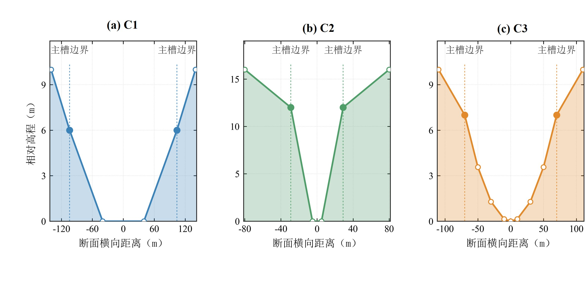

图1 C1、C2和C3的横断面形态

合成洪水采用单峰Beta函数构造，该类函数能够灵活控制峰现时间和过程形态[23]。令无量纲时间为：

|  | $$ x=\frac{t-{t}_{s}}{D},0\lex\le1, $$ | (16) |
| --- | --- | --- |

其中，${t}_{s}$为过程开始时刻，$D$为洪水历时。Beta函数及其归一化形式为：

|  | $$ f(x;\alpha,\beta)=\frac{{x}^{\alpha-1}(1-x{)}^{\beta-1}}{B(\alpha,\beta)}, $$ | (17) |
| --- | --- | --- |
|  | $$ g(x)=\frac{f(x;\alpha,\beta)}{{max}_{0\lex\le1}f(x;\alpha,\beta)}. $$ | (18) |

入流过程表示为：

|  | $$ I(t)={Q}_{b}+({Q}_{p}-{Q}_{b})g(x), $$ | (19) |
| --- | --- | --- |

式中，${Q}_{p}$和${Q}_{b}$分别为洪峰流量和初始稳定流量。令$r={T}_{p}/D$为峰现时间比例，其中${T}_{p}$为从洪水过程开始至洪峰出现的历时，$c$为过程集中度，则：

|  | $$ \alpha=1+r\left(c-2\right),  \beta=1+(1-r)(c-2). $$ | (20) |
| --- | --- | --- |

根据预设参数范围，采用分层拉丁超立方方法生成100场合成洪水，其中70场用于率定，30场用于测试[24]。各河槽及水力工况采用相同的洪水样本和划分方式。主要试验设置见表3，测试期洪水入流过程见图2。

表3 HEC-RAS试验设置及合成洪水参数

| 项目 | 设置 |
| --- | --- |
| 河道长度与评价断面 | 120 km；沿程每隔10 km设置1个评价断面，共12个 |
| 河槽形态 | C1宽浅复合断面；C2窄深复合断面；C3平滑近抛物线断面 |
| 基准水力条件 | 河道比降0.20‰；曼宁糙率系数0.035 |
| 合成洪水 | 每种河槽或水力工况100场 |
| 数据划分 | 70场率定，30场测试 |
| 对比模型 | 马斯京根、非线性马斯京根、RWEC |
| 洪峰流量${Q}_{p}$ | 200～650 m3/s |
| 起始流量${Q}_{b}$ | 50～150 m3/s |
| 洪水历时$D$ | 36～96 h |
| 峰现比例$r$ | 0.15～0.55 |
| 形状集中度$c$ | 4～14 |

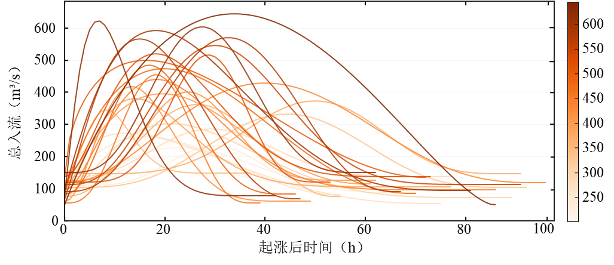

图2 测试期30场合成洪水入流过程

（2）河槽形态与传播距离下的模型表现

图3给出了三种模型在C1、C2和C3河槽中的测试精度随传播距离的变化，表4汇总了三类河槽的总体测试结果。短距离下，三种模型均保持较高精度；随着传播距离增加，两种马斯京根模型的NSE和KGE总体呈下降趋势、RMSE逐渐增大，其中线性模型的精度下降更为明显。RWEC在三类河槽中保持较高精度。至120 km处，马斯京根模型、非线性马斯京根、RWEC的平均NSE分别为0.74、0.80和0.97，平均RMSE分别为37.09、30.29和12.36 m³/s。

表4 C1、C2和C3的测试集总体精度

| 模型 | NSE | KGE | RMSE/(m³/s) |
| --- | --- | --- | --- |
| 马斯京根 | 0.91 | 0.88 | 16.75 |
| 非线性马斯京根 | 0.94 | 0.93 | 12.21 |
| RWEC | 0.99 | 0.98 | 8.01 |

在所采用的模型配置下，显式传播滞时与互补调蓄关系的组合能够同时拟合时间位移和过程变形。不同河槽中的模型差异并不相同：相较于窄深型C2，C1和C3条件下两种马斯京根模型的精度随距离增加下降更为明显。这一现象表明，断面形态与演算尺度会影响简化蓄泄关系的适用性。

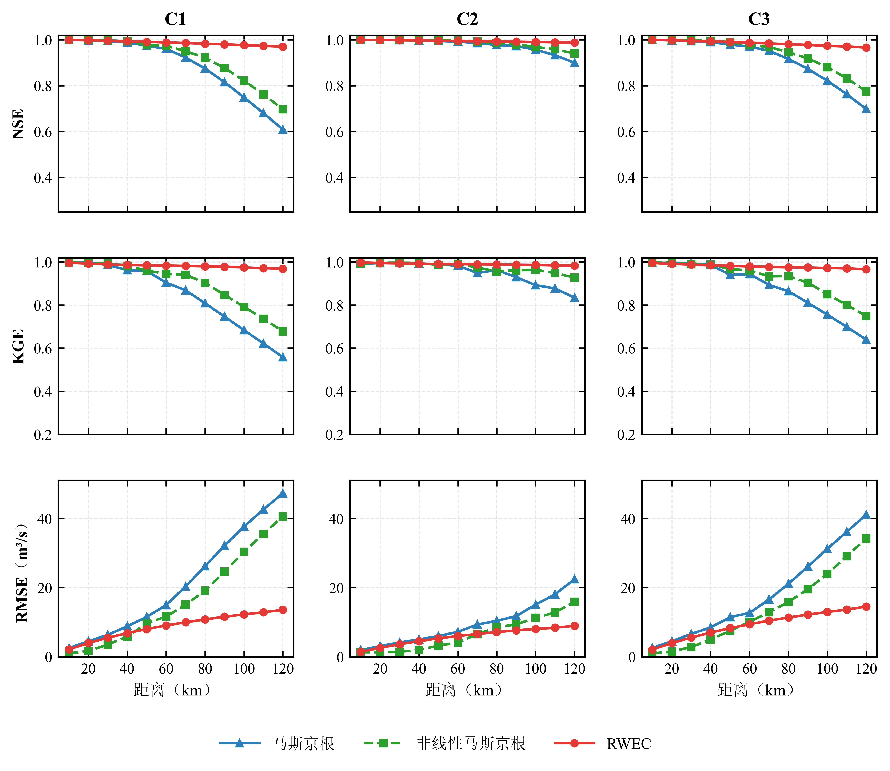

图3 三类河槽中三种模型的测试精度随传播距离的变化

图4给出了RWEC参数随传播距离的变化。三类河槽中，$\tau$均随传播距离增加而增大，C1和C3较为接近，C2整体较小，表明显式时滞参数对演算尺度具有响应。$k$和$n$的沿程轨迹在不同河槽之间存在差异，反映了互补调蓄关系为匹配不同流量过程所作的参数调整。

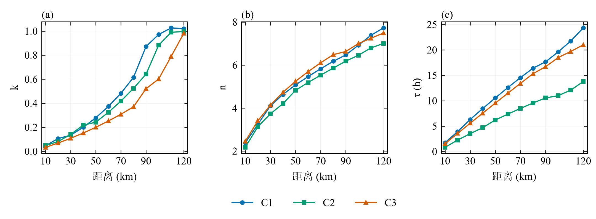

图4 C1、C2和C3中RWEC参数随传播距离的变化

（3）不同河道比降与糙率下的模型响应

以C3河槽为基础，分别设置不同河道比降和糙率工况。各组试验仅改变其中一个因素，其余条件保持一致，并采用相同的合成洪水样本及率定—测试划分。具体设置见表5。

表5 不同河道比降和糙率试验方案

| 方案 | 河道比降/‰ | 曼宁糙率系数 |
| --- | --- | --- |
| S1 | 0.10 | 0.035 |
| S2 | 0.20 | 0.035 |
| S3 | 0.50 | 0.035 |
| S4 | 0.20 | 0.025 |
| S5 | 0.20 | 0.050 |

选取距上游120 km处的评价断面，比较不同水力条件下的模型表现，结果见图5。在五组方案下，RWEC的NSE和KGE保持在较高水平，RMSE整体较低，其平均NSE、KGE和RMSE分别为0.97、0.96和14.16 m³/s。两种马斯京根模型的评价指标分布更为分散，且随河道比降和糙率变化出现较明显波动。

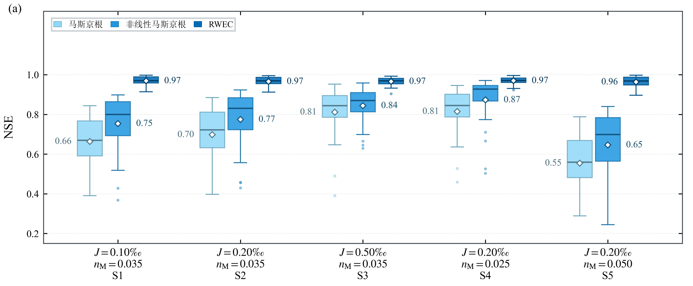

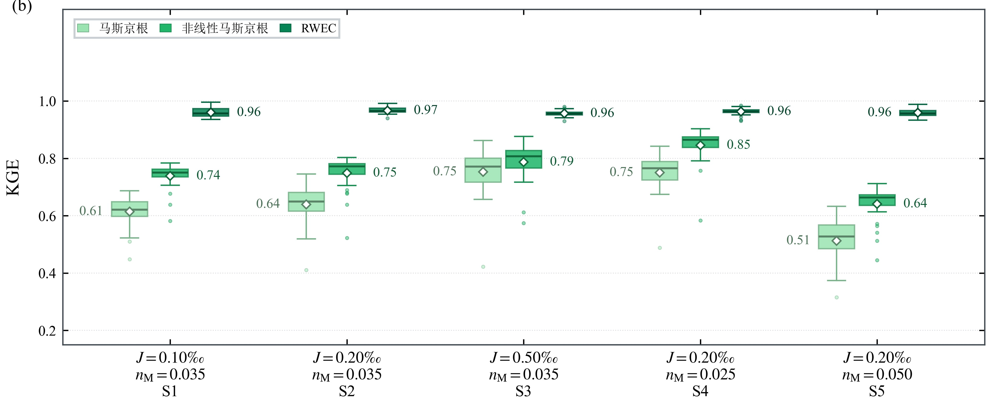

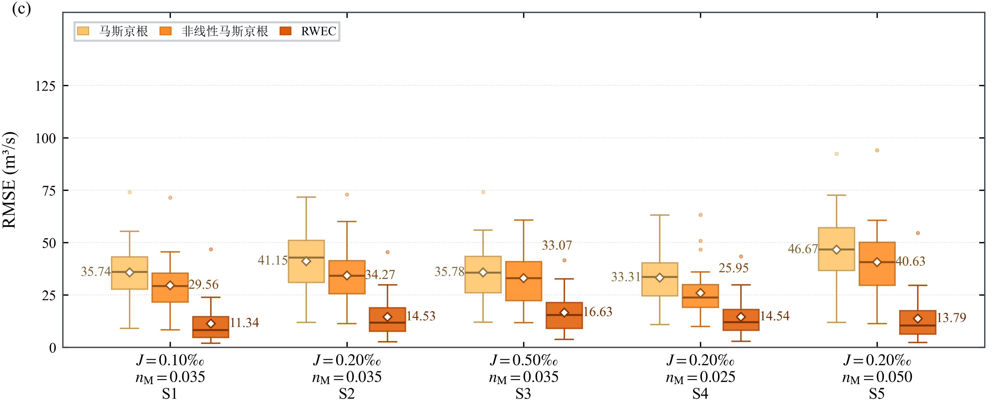

图5 各方案下三种模型在120 km断面的测试精度

注：箱体下、上边界分别为第25、第75百分位数，箱内横线为中位数，白色菱形为均值，旁列数值为均值；须线延伸至距箱体边界1.5倍四分位距以内的最远观测值，须线外散点为异常值。每个方案、模型包含30场测试洪水。

图6展示了不同河道比降和糙率条件下的RWEC参数。糙率固定为0.035时，$k$和$n$随河道比降增大整体减小；$\tau$在各比降下均随传播距离增加，但同一距离处不同坡降对应的$\tau$并不呈严格单调次序。河道比降固定为0.20‰时，$k$、$n$和$\tau$总体上随糙率增加而增大。

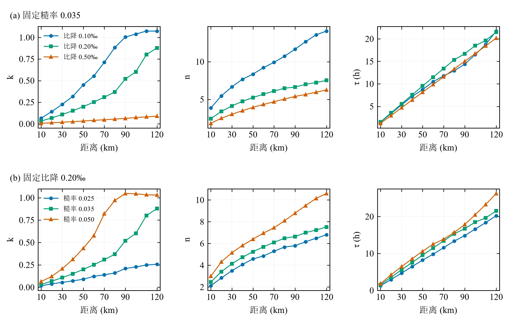

图6 C3河槽不同河道比降和糙率下RWEC参数随传播距离的变化

（4）有效传播时间的洪水传播表征

以各组合测试期30场洪水洪峰滞时的中位数Tp为参照，比较C1、C2和C3在12个传播距离下的36组有效传播时间τ。复算得到Pearson相关系数为0.986，τ/Tp中位数为78.4%，与原分析一致。进一步计算τ−Tp及τ/Tp（图7），36组τ均小于Tp，τ−Tp的均值为−2.98 h，范围为−7.21～−0.44 h；τ/Tp的均值为77.4%，标准差为10.1个百分点，范围为41.4%～89.5%。C1、C2、C3的τ/Tp中位数分别为80.3%、70.4%和86.1%，表明这一比值随河槽形态而变，并非可以跨河槽直接采用的常数。沿程绝对差值总体增大，比例差异则不呈统一单调变化。高相关性反映两者对传播尺度变化的共同响应，不能据此将τ与完整洪峰滞时视为数值相等。

为区分模型串联结构中的峰时调整，将纯时间平移后的峰现时刻作为传播单元输出，再计算调蓄单元引起的峰时变化：

$$
\Delta{T}_{s}={T}_{p,sim}-\tau
$$

$$
{e}_{t}={T}_{p,sim}-{T}_{p,ref}=(\tau-{T}_{p,ref})+\Delta{T}_{s}
$$

这里的两类峰时调整构成代数分解，不是河道平流与扩散的唯一物理归因。对C1、C2、C3各360个测试过程，调蓄峰时调整量的均值分别为4.96、4.48和4.02 h，纯平移相对于参照洪峰滞时的平均差分别为−3.31、−3.37和−2.36 h，两项叠加后最终平均峰时误差分别为1.65、1.11和1.65 h。因此，调蓄单元总体补偿了纯平移所留下的提前量，但部分补偿超过参照峰时，形成正的最终时间误差。逐场分解满足上述恒等式。

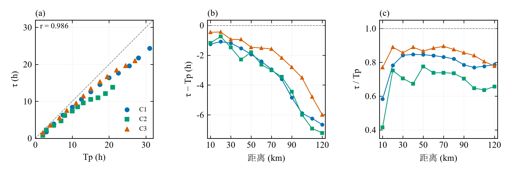

图7 有效传播时间与洪峰滞时的对应关系及其差异

### 4.3 天然河段洪水验证

选取清江和笋溪河两个天然河段开展洪水演算验证。清江取水布垭—隔河岩河段，长约92 km，上、下游坝址均采用历史还原流量资料，分别作为模型输入与演算参照；笋溪河取蔡家站—先锋站河段，长约43.7 km，采用两站实测流量资料。两河段均选取区间来水影响较小的洪水过程：清江8场，前6场用于率定、后2场用于测试；笋溪河9场，前7场用于率定、后2场用于测试。为保持河段水量平衡，将区间来水量按照上游入流过程各时段流量所占比例分配至上游断面。两河段计算时段分别为3 h和1 h；测试阶段各模型均固定采用相应河段的率定参数。资料划分及RWEC率定参数见表6。

表6 两个天然河段的参数率定结果

| 河段 | 马斯京根 | 非线性马斯京根 | RWEC |  |  |  |  |  |
| --- | --- | --- | --- | --- | --- | --- | --- | --- |
|  | $K$(h) | $$ X $$ | $K$(h) | $$ X $$ | $$ m $$ | $$ k $$ | $$ n $$ | $\tau$（h） |
| 清江 | 5.78 | 0.26 | 41.16 | 0.33 | 0.80 | 0.02 | 1.13 | 4.17 |
| 笋溪河 | 9.12 | 0.05 | 50.28 | 0.15 | 0.69 | 1.12 | 2.93 | 4.66 |

两个河段三种模型的测试结果列于表7。清江测试洪水中，RWEC的平均NSE和KGE分别为0.97和0.95，平均RMSE为577.57 m³/s；相较于非线性和线性马斯京根模型，RMSE分别降低12.17%和15.69%。笋溪河测试洪水中，RWEC的平均NSE和KGE分别为0.93和0.92，平均RMSE为9.43 m³/s；相较于非线性和线性马斯京根模型，RMSE分别降低20.96%和33.92%。在两个河段内，RWEC的三项平均指标均优于相应对照模型，其相对精度改善在笋溪河中更为明显。

表7 两个天然河段三种模型的测试结果

| 模型 | 清江 | 笋溪河 |  |  |  |  |
| --- | --- | --- | --- | --- | --- | --- |
|  | NSE | KGE | RMSE（m3/s） | NSE | KGE | RMSE（m3/s） |
| 马斯京根 | 0.95 | 0.89 | 685.06 | 0.83 | 0.84 | 14.27 |
| 非线性马斯京根 | 0.95 | 0.92 | 657.63 | 0.88 | 0.90 | 11.93 |
| RWEC | 0.97 | 0.95 | 577.57 | 0.93 | 0.92 | 9.43 |

图8和图9分别给出清江和笋溪河测试洪水的演算过程。清江两场洪水分别呈现双峰和单一主峰特征，RWEC能够跟随主要涨落过程。笋溪河两场测试洪水中，RWEC的全过程主峰流量相对误差分别为10.48%和1.08%，峰现时间误差分别为−1 h和0 h。第一场洪水以单一主峰为主，RWEC较好地给出峰现时间，但存在洪峰高估；第二场包含多个局部峰值，RWEC对全局主峰的幅值和时间拟合较好。两场结果尚不足以建立洪峰偏差与洪水类型之间的稳定统计关系。

对第二场笋溪河洪水，两种马斯京根模型的全过程最大模拟峰出现在后一个局部峰附近，直接比较全局主峰会得到30 h的时间差；以参照主峰相邻谷点限定相同匹配窗口后，两种模型在该窗口的峰时误差均为0 h，峰值误差分别为−34.25%和−29.03%。这一现象反映主次峰幅值排序的变化，不能仅解释为同一洪峰整体滞后30 h。

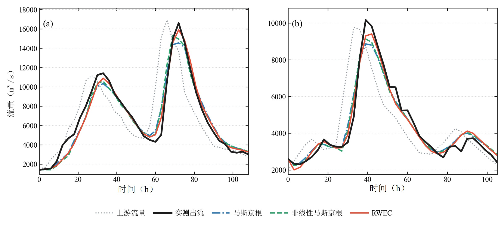

图8 清江两场测试洪水的三模型演算过程

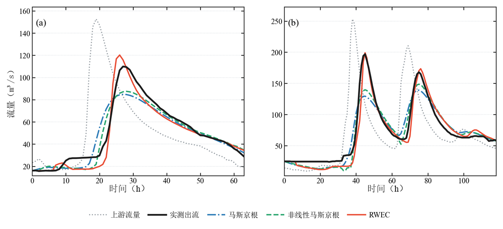

图9 笋溪河两场测试洪水的三模型演算过程

k和n分别调节潜在滞蓄增量和互补曲线形态。对给定的前期状态与当前到达水量，增大k会提高潜在滞蓄量，并增加时段末有效滞蓄量，从而减少当期出流；这一局部作用不等同于整场洪水中始终具有更高滞蓄量，因为状态会随递推改变。对给定的两类约束，n增大时有效滞蓄量趋近其中较小者，因而n表征约束组合的曲线形态，而非某一项直接可测的水力参数。本文控制试验显示参数会随断面、比降、糙率和距离变化，但目前尚未建立由这些水力要素唯一确定k、n的关系。参数间还可能通过状态调整产生补偿，同样的过程拟合精度未必对应唯一的参数组合。跨河段迁移应同时检验河道条件相似性、流量范围、时间尺度与参数可辨识性，并以未参与率定的洪水检验；本文结果不能替代这一验证。

### 5 结论

（1）本文采用水能互补方程的双重约束形式构建RWEC河道洪水演算模型，以有效传播时间表征显式时滞，以可供水量和潜在滞蓄量共同确定时段末有效滞蓄状态，并根据水量平衡计算出流。这里的互补关系是河道蓄泄分配的概念性本构表达，其应用不意味着直接引入或求解河道水流能量约束。

（2）HEC-RAS控制试验表明，在本文所采用的河槽形态、传播距离、河道比降及糙率条件下，RWEC保持较高演算精度。在120 km断面，RWEC、非线性马斯京根和线性马斯京根模型的平均NSE分别为0.97、0.80和0.74。36组有效传播时间与参照洪峰滞时高度相关，但全部小于参照值，τ/Tp随河槽形态和传播距离变化。显式传播时滞对应理想资料条件下的理论信息提前量，实际业务预见期仍须独立验证。现有三模型比较反映完整模型结构的差异，尚不能单独量化互补关系相对于显式时滞的独立增益。

（3）清江与笋溪河测试洪水中，RWEC的平均NSE分别为0.97和0.93，平均RMSE分别为577.57和9.43 m³/s。两河段结果支持模型在所检验样本中的过程模拟能力；笋溪河第一场测试洪水仍存在约10.48%的主峰高估。独立测试仅涵盖两个河段的四场洪水，尚不能据此确定对各类洪水的普遍适用性，也不能证明参数可以直接跨河段迁移。跨时间尺度稳定性、复杂水力条件下的表现及传播与调蓄作用的独立贡献，仍需更多独立资料和统一条件下的结构对照检验。

参考文献

［1］石朋，樊鑫洋，陈干琴，等. 基于马斯京根法的区间洪水推求方法［J］. 河海大学学报（自然科学版），2024，52（6）：1-7. （Shi Peng，Fan Xinyang，Chen Ganqin，et al. An inter-basin flood calculation method based on Muskingum routing method［J］. Journal of Hohai University （Natural Sciences），2024，52（6）：1-7. （in Chinese））

［2］Bindas T，Tsai W P，Liu J，et al. Improving river routing using a differentiable Muskingum-Cunge model and physics-informed machine learning［J］. Water Resources Research，2024，60（1）：e2023WR035337.

［3］南统超，施睿，于春水. 基于国产CPU/GPU平台的水动力模型异构并行计算［J］. 水利学报，2025，56（6）：771-779. （Nan Tongchao，Shi Rui，Yu Chunshui. Hydrodynamic modeling via heterogeneous parallel computing on domestic CPU/GPU platform［J］. Journal of Hydraulic Engineering，2025，56（6）：771-779. （in Chinese））

［4］Young A，Albertson J D，Moretti G，et al. Real-time flood inundation modeling with flow resistance parameter learning［J］. Water Resources Research，2025，61（1）：e2024WR038424

［5］王船海，俞悦，吴金宁，等. 基于马斯京根参数 K、X 的等效河道计算方法研究［J］. 水利学报，2023，54（10）：1257-1265. （Wang Chuanhai，Yu Yue，Wu Jinning，et al. Research on calculation method of equivalent channel based on Muskingum parameters K and X［J］. Journal of Hydraulic Engineering，2023，54（10）：1257-1265. （in Chinese））

［6］Cunge J A. On the subject of a flood propagation computation method （Muskingum method）［J］. Journal of Hydraulic Research，1969，7（2）：205-230.

［7］罗赟，张翔宇，董增川，等. 基于物理机制耦合深度学习的黄河干流流量演进模拟［J］. 水科学进展，2025，36（2）：217-229. （Luo Yun，Zhang Xiangyu，Dong Zengchuan，et al. Simulation of river flow evolution in the Yellow River main stream based on the coupling of physical mechanisms and deep learning［J］. Advances in Water Science，2025，36（2）：217-229. （in Chinese））

［8］Liao M，Barros A P. Modeling celerity-discharge behavior and riverbank storage for improving flood simulations in headwater basins［J］. Water Resources Research，2025，61（8）：e2024WR038446.

［9］刘其，朱冰，李思昊，等. 实时洪水预报误差多断面联合校正方法［J］. 水科学进展，2026，37（1）：107-119. （Liu Qi，Zhu Bing，Li Sihao，et al. Multi-site joint correction method for real-time flood forecasting errors［J］. Advances in Water Science，2026，37（1）：107-119. （in Chinese））

［10］芮孝芳，刘宁宁，凌哲，等. 单位线的发展及启示［J］. 水利水电科技进展，2012，32（2）：1-5. （Rui Xiaofang，Liu Ningning，Ling Zhe，et al. Development and inspiration of unit hydrograph［J］. Advances in Science and Technology of Water Resources，2012，32（2）：1-5. （in Chinese））

［11］闫宝伟，李正坤，霍磊，等. 异参离散广义 Nash 汇流模型及应用［J］. 水利学报，2019，50（7）：874-880. （Yan Baowei，Li Zhengkun，Huo Lei，et al. Discrete generalized Nash model with unequal storage parameters and its application［J］. Journal of Hydraulic Engineering，2019，50（7）：874-880. （in Chinese））

［12］Budyko M I. The heat balance of the earth's surface［J］. Soviet Geography，1961，2（4）：3-13.

［13］Yang H，Yang D，Lei Z，et al. New analytical derivation of the mean annual water-energy balance equation［J］. Water Resources Research，2008，44（3）：W03410.

［14］Zou Y，Yan B，Gu D，et al. A water-energy complementary model for monthly runoff simulation［J］. Journal of Hydrology，2024，639：131624.

［15］Yan B，Du S. A generalized water-energy complementary model for hydrological partitioning［J］. Journal of Hydrology，2025，663：134230.

［16］Yan B，Chang J. A watershed-scale rainfall infiltration model incorporating water and energy constraints［J］. Journal of Hydrology，2025，661：133561.

［17］Ponce V M，Shetty A V. A conceptual model of catchment water balance：1. Formulation and calibration［J］. Journal of Hydrology，1995，173（1-4）：27-40.

［18］Wu S，Zhao J，Sivapalan M. A parsimonious daily water balance model based on the proportionality hypothesis［J］. Journal of Hydrology，2025，649：132414.

［19］Zhao J，Wang D，Yang H，et al. Unifying catchment water balance models for different time scales through the maximum entropy production principle［J］. Water Resources Research，2016，52（9）：7503-7512.

［20］Wang D，Tang Y. A one-parameter Budyko model for water balance captures emergent behavior in Darwinian hydrologic models［J］. Geophysical Research Letters，2014，41（13）：4569-4577.

［21］Gill M A. Flood routing by the Muskingum method［J］. Journal of Hydrology，1978，36（3-4）：353-363.

［22］Storn R，Price K. Differential evolution：A simple and efficient heuristic for global optimization over continuous spaces［J］. Journal of Global Optimization，1997，11（4）：341-359.

［23］Brunner M I，Viviroli D，Sikorska A E，et al. Flood type specific construction of synthetic design hydrographs［J］. Water Resources Research，2017，53（2）：1390-1406.

［24］Jafarzadegan K，et al. Quantifying cascading uncertainty in compound flood modeling with linked process-based and machine learning models［J］. Hydrology and Earth System Sciences，2024，28：2531-2555.

A river flood routing method based on the water-energy complementary equation

YAN Baowei, YANG Dongxu, CHANG Jianbo, DU Shixiong, ZHOU Xuerui

(School of Civil and Hydraulic Engineering, Huazhong University of Science and Technology, Wuhan 430074, China)

Abstract: A river flood routing model using the dual-constraint mathematical form of the water-energy complementary equation, termed RWEC, is developed to represent hydrograph changes arising from propagation lag and channel storage and release. The model uses an effective propagation time to represent an explicit temporal shift of the inflow hydrograph. The application is a conceptual storage relation rather than a derivation from the hydraulic energy equation. Effective storage is jointly constrained by the available water volume and potential storage, and reach outflow is obtained from the water balance. Controlled experiments are conducted using a 120 km idealized channel constructed in HEC-RAS, with varying cross-sectional geometries, propagation distances, channel slopes, and roughness values. RWEC is compared with linear and nonlinear Muskingum models and further evaluated using observed floods from the Qingjiang and Sunxi rivers. Under the adopted experimental settings, RWEC maintains high routing accuracy across the tested channel conditions, and its performance advantage over the two benchmark models becomes more apparent with increasing propagation distance. At the 120 km section, the mean Nash–Sutcliffe efficiency values of RWEC, the nonlinear Muskingum model, and the linear Muskingum model are 0.97, 0.80, and 0.74, respectively. For the test floods in the Qingjiang and Sunxi rivers, RWEC achieves mean Nash–Sutcliffe efficiency values of 0.97 and 0.93 and mean root-mean-square errors of 577.57 and 9.43 m³/s, respectively, outperforming the corresponding benchmark models. The comparison evaluates the complete model structures and does not isolate the gain from the complementary relation alone. These results indicate that combining an explicit propagation lag with a complementary storage relation can reproduce downstream hydrographs under the selected channel conditions and flood samples, providing a parsimonious constitutive representation for conceptual river flood routing.

Key words: river flood routing; water-energy complementary equation; propagation lag; effective storage; Muskingum model

作者简介：闫宝伟，男，山东省滨州市人，副教授，博士。主要从事水文基础理论研究。E-mail：bwyan@hust.edu.cn，电话：15171507240。

---

## 审稿意见逐条回复

《水利学报》审稿意见逐条回复

Response to Reviewers

| 稿件编号 | jhe20260716 |
| --- | --- |
| 稿件名称 | 基于水能互补方程的河道洪水演算方法 |

工作版说明：本文件逐条记录已完成修改与仍需补算或核实的内容，尚不能直接作为投稿回复。已完成内容对应本轮红字工作稿；其余事项保持待核状态。当前稿件题目按作者意见保留。

尊敬的编辑及各位审稿专家：

感谢编辑及两位审稿专家的审阅。我们按照13条意见逐项修订，并补充了36组传播时间差异分析、1080个测试过程的峰时分解及笋溪河逐场洪峰评价。下文说明实际完成的修改，同时列明尚需核实的数值来源和补充对照试验。本稿是返修工作版，正式提交前将删除全部工作状态说明并统一页码。

谨向编辑及审稿专家致以诚挚谢意。

### 一、对审稿人1意见的回复

感谢审稿专家对本文研究思路、模型结构和所选测试条件下模拟表现的肯定。针对提出的三项意见，回复如下。

### 意见 1

审稿意见：建议进一步说明题目中“水能互补方程”的含义及适用性。该术语虽有文献依据，但本文将其用于可供水量与潜在滞蓄量共同约束的河道调蓄过程，其中“能”与原框架中能量约束的对应关系尚不清楚。请说明这一应用的物理依据，以及两类约束与原框架的对应关系，并在文中明确该术语的具体含义。若主要是借鉴既有方程的数学形式，建议考虑调整题目表述。

作者回复：感谢专家指出术语对应关系不清的问题。我们保留原题，同时在引言、第2章末段和第3章开头明确：本文借鉴的是已有水能互补方程的双重约束数学形式。可供水量表示水量供给约束，潜在滞蓄量表示概念性滞蓄水平；后者不是水流机械能，也不是直接从能量方程得到的河槽容量。修订文字将数学形式推广与力学推导区分，并说明本构假设需由边界条件、过程响应和独立资料检验。

修改内容及位置：已修改；引言第二段、第2章式（8）后、第3章开头、中文摘要、英文摘要及结论（1）。论文题目保留。

### 意见 2

审稿意见：本文同时引入显式传播时滞，并采用水能互补方程描述河道调蓄，现有对比尚难区分两者对精度提升的贡献。建议增加采用相同时滞处理的常规调蓄模型作为对照，以明确水能互补方程对精度提升的作用。

作者回复：我们同意，原有对比不能独立识别显式传播时滞与互补关系的贡献。这一条尚未完成补算，当前不宣称互补关系具有已被独立证实的精度增益。已制定两组对照：固定与RWEC相同的时滞后分别率定Lag-MK和Lag-NMK的其余参数；再允许两种新增模型独立率定时滞，检查固定时滞是否造成结构偏向。各组必须采用相同资料、初始条件、时间离散、率定目标和测试划分，并记录参数数目、数值可行性和边界命中。补算后依据实际结果修订摘要、结果及结论。

修改内容及位置：待补算；任务A。第4.1节及第4.2、4.3节待加入对照结果。现阶段已在结论（2）限定原有三模型比较的归因范围。

### 意见 3

审稿意见：论文主要采用NSE、KGE和RMSE评价整体流量过程，对洪峰大小和出现时间的误差缺少直接评价。建议补充各场洪水的洪峰相对误差和峰现时间误差，并比较不同模型的结果，以更直接地检验模型对洪峰大小及传播时间的模拟能力。

作者回复：已补充带符号的洪峰相对误差和峰现时间误差定义，并复算笋溪河两场测试洪水的三模型指标。RWEC两场洪峰误差为10.48%和1.08%，峰时误差为−1 h和0 h。多峰场次同时报告全局主峰与同一参照峰窗口的指标：两种马斯京根模型全局最大峰发生主次峰转换，得到30 h的全局时间差；在相同参照主峰窗口内，两者峰时误差均为0 h。这两类指标含义不同，已予区分。清江逐时结果尚未匹配送审稿RWEC平均RMSE，故其新增数字暂不写入稿件；四场洪水全套指标完成后再关闭本条。

修改内容及位置：部分完成；第4.1节评价方法、第4.3节图8和图9前的分析。已输出笋溪河逐场指标和多峰匹配窗口；清江指标待任务A核定资料后补齐。

### 二、对审稿人2意见的回复

感谢审稿专家对论文创新性及试验设计的肯定，也感谢专家对机理分析、适用性和表达规范提出的具体建议。现逐条回复如下。

### 意见 1

审稿意见：论文提出有效传播时间τ，结果显示τ普遍小于实际洪峰滞时，文中说明洪峰时刻由时滞与蓄泄共同调节，但缺少定量区分传播单元、调蓄单元分别对峰现时间误差贡献的分析，请进一步补充讨论该模型峰现时间误差的来源。

作者回复：已按模型串联结构逐场分解1080个HEC-RAS测试过程。调蓄峰时调整量定义为模拟峰滞时减去τ，最终误差等于纯平移相对于参照峰滞时的差与该调整量之和。C1、C2、C3的调蓄调整均值分别为4.96、4.48和4.02 h；纯平移差的均值分别为−3.31、−3.37和−2.36 h；最终平均峰时误差分别为1.65、1.11和1.65 h。逐场代数核验通过。该分解说明调蓄单元对峰时的补偿及过度补偿，不是对实际平流与扩散作用的唯一归因。天然河段的完整分解尚待清江资料核定。

修改内容及位置：HEC部分已完成；第4.2节（4）新增峰时分解公式及定量分析。天然河段部分仍待补齐。

### 意见 2

审稿意见：天然河段验证仅选用清江、笋溪河2个河段，样本数量有限。文中结论提到“部分洪峰仍存在偏差”，没有归纳洪峰偏差出现的洪水特征，建议补充统计分析，或者明确该模型的适用洪水类型。

作者回复：已将适用性结论限定于所检验样本。笋溪河第一场以单一主峰为主，RWEC有10.48%的峰值高估且提前1 h；第二场含多个局部峰，全局主峰误差为1.08%，峰时误差为0 h。现有样本不足以建立误差与洪水类型的稳定统计关系，故不以这两场结果推断特定类型普遍适用或不适用。清江对应逐场指标待资料来源核定后补充；最终将结合四场过程特征描述偏差，并保留样本量限制。

修改内容及位置：部分完成；第4.3节图8和图9前的分析及结论（3）。清江过程特征与新增指标待核。

### 意见 3

审稿意见：结论部分第(3)点提出有待开展跨河段参数迁移检验，但全文没有对模型参数的物理可解释性做充分讨论，k、n与河道比降、糙率、断面形态的定量关系尚不明确，请补充讨论参数物理含义，说明参数区域移植的可行性与难点。

作者回复：已在第3章和第4.3节补充k、n的数学作用及迁移限制。在其他即时条件固定时，k增大使潜在滞蓄量和有效滞蓄量增加，但递推状态变化后不能简单断言整场蓄量始终更高；对给定两类约束，n增大使有效滞蓄量趋近较小约束。k、n是有物理指向的概念参数，尚不能由比降、糙率及断面形态唯一确定。现有控制试验给出响应趋势，尚未建立区域移植公式。补充文字明确了参数补偿、可辨识性及独立资料验证的必要性。

修改内容及位置：已修改；第3章式（11）后的解释、第4.3节末段和结论（3）。本轮未宣称已建立定量参数迁移关系。

### 意见 4

审稿意见：文中评价断面设置为10、20、…、120  km，但图4、图6横轴最大刻度仅到110  km，建议将横轴刻度拓展至120 km，与试验设置保持一致。

作者回复：已重绘图4及图6，各子图均明确显示120 km刻度，且120 km数据点完整可见。重绘使用原有图源数据，未改动率定节点，也未补入插值节点。

修改内容及位置：已修改；图4、图6。修订图件同时保留可编辑SVG、PDF及600 dpi TIFF。

### 意见 5

审稿意见：文中RWEC模型可提供长度为τ的理论预见期，用于实时洪水预报。请明确该预见期是理论上限，还是可直接应用于实际作业预报；当入流存在观测误差时，预见期性能是否会受影响，请补充说明。

作者回复：已将第3章的预见期解释限定为参数和初始状态已知、历史入流按计算要求及时获得时的理论信息提前量，并明确不等同于已经验证的业务有效预见期。新增文字说明观测误差、传输延迟、初始状态与参数误差对预报的影响，并要求非整数时滞的构造只能使用发布时刻已可用的资料。本文未新增业务预报实测检验，相关结论保持限定。

修改内容及位置：已修改；第3章式（12）后及结论（2）。资料插值方式的数值一致性另列于审稿人2意见10，仍需核查。

### 意见 6

审稿意见：全文多处物理量与单位之间缺少半角空格，请全文统一量‑单位排版规范。

作者回复：已检查并统一正文、摘要、表题图题中数值与km、h、m³/s等单位的间距，修订文字使用半角空格。新绘图件英文和数字采用Times New Roman，中文采用宋体。

修改内容及位置：已修改并抽查；摘要、第4.2和4.3节、表3、图5图题、结论等。最终合稿还须在页码锁定后作一次全文排版复核。

### 意见 7

审稿意见：表1、表3中的数值范围连接符号用法不统一，请全文统一范围号格式。

作者回复：已统一表1和表3数值范围连接符为“～”，并检查同类数值范围的正文写法。负数符号及文献页码连接符保持其本来含义。

修改内容及位置：已修改；表1、表3及相应数值区间。另发现表1的实际搜索边界需重新核对，已作为数值复核事项单独登记。

### 意见 8

审稿意见：图7给出τ与洪峰滞时Tp相关关系，仅给出Pearson相关系数0.986。建议增加残差分析，分析不同河道形态、不同距离条件下τ/Tp比值的离散程度，说明该比值是否存在系统偏差。

作者回复：已从原始HEC-RAS逐时过程复算每个组合30场测试洪水的峰滞时中位数，形成36组对照，并扩展图7。Pearson相关系数复算为0.985673，τ/Tp中位数为78.37%。36组τ−Tp均为负，均值−2.98 h，范围−7.21～−0.44 h；τ/Tp均值77.45%，样本标准差10.08个百分点。C1、C2、C3的比值中位数为80.27%、70.39%和86.14%，范围分别为58.26%～84.65%、41.44%～77.55%和76.95%～89.46%。因此比值存在河槽间差异，不能以高相关性支持数值一致或使用统一比例。图7补充了按距离排列的差值和比值，分组统计表及逐组数据已归档。

修改内容及位置：已完成；第4.2节（4）和扩展后的图7。另附36组原始分析表及按河槽、距离的统计表。

### 意见 9

审稿意见：图5箱线图未对箱体、须线、异常散点的含义进行说明，建议在图注补充箱线图各元素释义。

作者回复：已核对图源程序和原图中的统计标记，在图5图注中补充箱体第25/75百分位数、中位线、白色均值菱形、旁列均值数字、1.5倍四分位距须线及异常散点的含义，并注明每组包含30场测试洪水。

修改内容及位置：已修改；图5图注。

### 意见 10

审稿意见：第3页公式(10)(11)定义It−τ为时段平均入流，但段落文字表述写为“获取实时入流It−τ”，文字描述和符号定义矛盾，请修改文字表述，厘清“实时入流”与“时段平均入流”概念。

作者回复：已删除第3章“获取实时入流”的表述，明确理论公式中的变量为相应历史计算时段的平均入流，并补充发布时刻资料可用性的要求。代码核查发现，HEC-RAS通用实现与笋溪河复现实现对入流离散方式的处理并不相同：后者实际调用平移后的插值点值。因此，仅修改措辞尚不能关闭本条。下一步须核定原始记录为时段平均量还是瞬时值，统一入流构造并复算受影响结果，不能把点值实现直接写成已采用时段积分或平均。

修改内容及位置：文字已修改，数值一致性待核；第3章式（10）—（12）及其后说明。任务A将核定数据时间含义，并执行非整数时滞与资料可用性检查。
